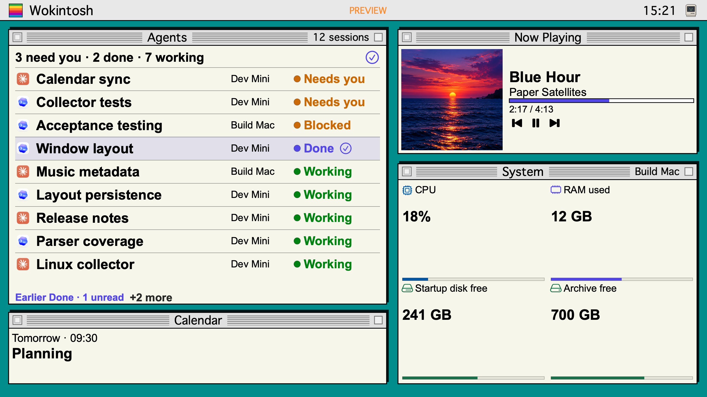
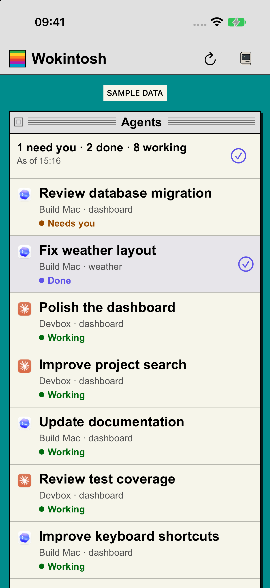
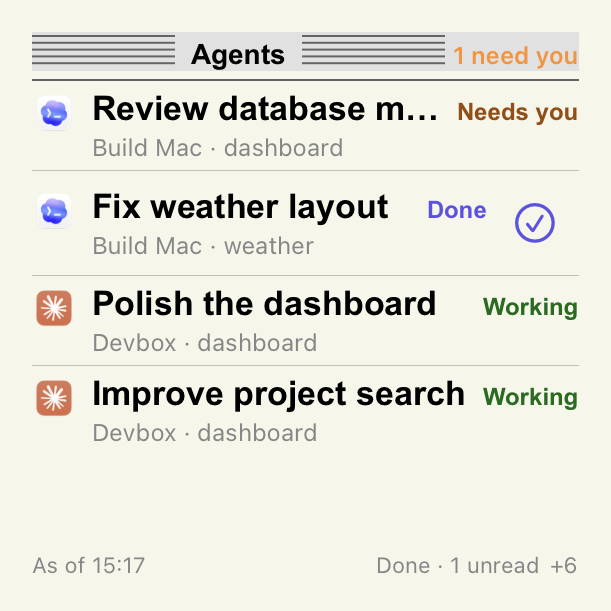
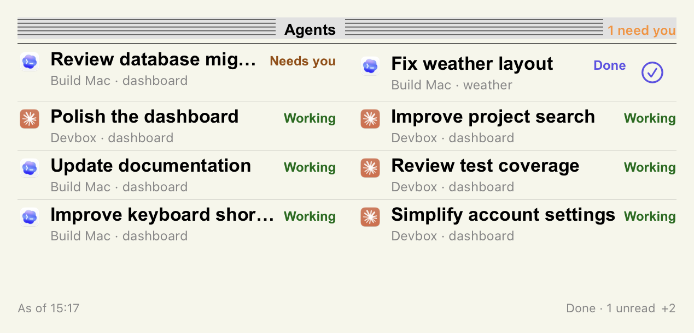

# Wokintosh

A Color Classic-style dashboard for coding agents, music, calendar, weather and system readings. Codex and Claude Code are supported, with **Untested Antigravity App/CLI and OpenCode App/CLI integrations** in 2.1. Designed for and tested on the [Wokyis M5 (10Gbps) retro docking station](https://wokyis.com/products/wokyis-m5-10gbps), with its **5-inch 1280 × 720 display**.



**[Download Wokintosh](https://github.com/anandman/wokintosh/releases/latest)** — Apple silicon, macOS 14 or later. The app and DMG are signed and notarized. The companion agent supports macOS and Linux.

## Getting started

Drag Wokintosh to Applications and open it. **Click the Mac icon at the top right of the dashboard to open Settings**; **Command-comma** works too. Add and arrange widgets in Dashboard, connect Music or Calendar in Connections, and choose your presentation screen in Display.

Widgets can be resized and duplicated independently, with their own content and optional app/link actions. Completed agents stay highlighted Done until reviewed. Optionally choose **Collapse Done after** in an Agent widget’s Content settings to move older notices into **Earlier Done** while keeping them unread. Blocked goals remain visible so unfinished work is not forgotten.

Background tasks are tracked separately from foreground responses. Finite jobs keep a session **Working**; designated monitors show **Monitoring** between active turns. Monitoring stays visible below Working even with inactive sessions hidden, and does not count as Working. Right-click a session → **Background Tasks…** to choose **Automatic**, **Work** or **Monitor** for an individual runner. Automatic recognizes explicit provider monitors; ambiguous shell jobs count as work. Choices apply to the current task run and stay out of setup exports.

Claude task snapshots, launch/completion notifications and Codex command lifecycle records supply the evidence. Quiet or long-running processes are not classified by guesswork. When task activity cannot be verified, Wokintosh shows **Unknown** instead of assuming Done. Updates to the collector and the Mac/mobile apps are needed for the new task controls; older collectors continue working without task details.

Move your dashboard to another Mac with **Settings → Dashboard → (…) → Export Setup…**, then **Import Setup…** on the other Mac. Import previews machine mappings and creates a backup. **Export Shareable Template…** saves a starting layout with personal machine, location, calendar, and action settings removed.

Wokintosh checks for updates automatically and can download them in the background, installing when you quit. Use **Settings → Updates** or **Check for Updates** in the rainbow menu to install and relaunch sooner. Versions before 1.1 need one final manual installation.

## Remote machines

Wokintosh shows individual coding-agent sessions across machines over SSH. **Antigravity App/CLI and OpenCode App/CLI are Untested integrations**: adapters have fixture coverage, but have not been verified end to end with live provider sessions. Antigravity IDE is excluded. See [additional-provider setup and limitations](docs/PROVIDERS.md).

1. Make sure your SSH alias or `user@host` already connects from Terminal using keys and trusted host configuration.
2. In **Settings → Machines**, enter the machine name and SSH destination.
3. Choose **Install / Update over SSH**. Wokintosh finds a compatible Python, copies the collector and verifies the connection. Existing hooks and collector state are preserved.

Settings → Machines reports collector update availability, including a separately installed status observer. Older collectors show an unknown version until updated. A popup offers **Review Updates** or **Later**, and the dashboard reminder remains available. Choose **Update** for one machine or **Update All** for all connected machines needing an update, including an outdated local status observer. Updates run one machine at a time, with the active stage, waiting machines and individual results shown in Machines. A failed update leaves its error visible and the remaining updates continue. An existing private Wokintosh-managed observer copy is backed up and refreshed as part of a remote update.

The remote machine needs **Python 3.10 or later**. Versioned installations are detected even when the default `python3` is older. Agent and system collection uses SSH and needs no remote GUI, account, API key or listening server. Optional iPhone and iPad publishing on the display Mac is a separate feature described below.

Existing sessions are discovered automatically. Optional observer hooks improve permission/input status; they are enabled separately on each machine. See [agent setup and troubleshooting](docs/ADVANCED.md) for hooks, upgrades and blocked-goal integration.

## iPhone and iPad widgets

**Wokintosh 2.0 and later** provide private mobile publishing and an iPhone/iPad companion. See the [release notes](RELEASE_NOTES.md).

The universal iPhone/iPad app and medium/large Home Screen widgets are available as source builds for direct installation, including a full-width extra-large iPad widget and a tall option where iOS/iPadOS 27+ offers it. Session taps open the official app directly; missing or failed links show details. The download above installs the Mac app; build and install the mobile companion separately with Xcode. See the [build, installation and pairing guide](docs/IPHONE.md).

<p>
  
  
</p>



*Current UI rendered with fictional preview data. [More widget sizes and dark appearance](docs/IPHONE.md#preview-gallery).*

### Build with your own Xcode account

Until distribution is arranged, the iOS/iPadOS app is **roll your own**. You need a Mac with **Xcode 27+**, an Apple Account signed into Xcode, and an iPhone/iPad running **iOS/iPadOS 17+**.

```sh
git clone https://github.com/anandman/wokintosh.git
cd wokintosh
cp iOS/Config/Signing.local.xcconfig.example iOS/Config/Signing.local.xcconfig
open iOS/WokintoshPhone.xcodeproj
```

Edit the copied, Git-ignored configuration with your **Team ID**, a unique **app bundle ID** and your **App Group ID**. Select the **WokintoshPhone** scheme and your connected device, resolve signing for both the app and widget, and choose **Run**. The checked-in project needs no XcodeGen step. Free Personal Team installs expire after seven days; see [Apple's account limits](https://developer.apple.com/help/account/basics/about-your-developer-account).

Install Wokintosh 2.0 or later on the publishing Mac. To build it yourself, use `script/build_and_run.sh --build-only`, then quit the older app and open the staged app path it prints. The [complete guide](docs/IPHONE.md) covers identifiers, capabilities, Developer Mode, wireless installation, pairing and adding widgets. TestFlight distribution is a future decision.

### Private publishing and controls

The display Mac publishes only Agent widgets you select in **Settings → iPhone & iPad**. Publishing is off by default. The publisher binds to `127.0.0.1:8787`; Tailscale Serve supplies private HTTPS on port `9443`. Access also requires a private pairing key. This uses neither Tailscale Funnel nor a public relay. Keep Wokintosh and the Mac running; its dashboard window can be closed.

Optional **Allow Agent controls** lets paired devices review Done, change Wokintosh’s manual Blocked annotations and classify background runners as Work or Monitor. The display Mac saves the shared state; controls stay off by default. While enabled, the pairing key grants these controls as well as viewing access. Provider sessions remain observational.

The app uses the desktop’s classic Mac palette and provider icons. Tap a session to open it, tap the Done checkmark to review it, or long-press a row for manual Blocked controls and **Background Tasks…**. Runner choices sync through the display Mac; ordinary session taps still open the provider immediately. Connection and widget selection live in Settings (the Mac icon). Home Screen widgets keep compact classic styling, automatic dark appearance and a Done checkmark; iOS owns their long-press menu.

The paired device mirrors the selected widget’s filters and attention-first ordering. It shows an **As of** time and stale/offline states; iOS schedules widget refreshes and may take longer than the requested 15 minutes. Viewing or opening a session does not review Done notices, send a prompt or approve an action.

Antigravity and OpenCode use their official logos on Mac and mobile, including the dark OpenCode mark in dark widgets. Their sessions retain the same Done review and manual Blocked controls; mobile links remain unavailable until configured with a verified provider web URL. See [provider setup](docs/PROVIDERS.md).

Session links come from each collector. Claude opens with `claude://code/{bridge-id}`, with HTTPS as a backup; its Remote Control bridge ID is captured by observational hooks when available. This requires Remote Control to be connected and a Claude Code version exposing `CLAUDE_CODE_BRIDGE_SESSION_ID` (v2.1.199+). Wokintosh does not enable Remote Control or change `remoteControlAtStartup` automatically. Codex uses `codex://threads/{thread-id}` with the original thread UUID; this iOS route was verified on the initial user’s setup and remains an undocumented mobile contract. Missing links stay unavailable rather than guessing another session.

Publishing choices and pairing credentials stay on their device and are excluded from setup exports and templates. Importing a setup requires selecting its widgets for publication again. Stop publishing to prevent new access; unpair in the companion app to clear its retained snapshot.

## Remote Now Playing and Calendar

Use another Mac’s Apple Music and selected calendars without connecting those sources on the display Mac.

1. Install Wokintosh 1.3 or later on the source Mac and keep it running; its dashboard can be closed.
2. In that Mac’s **Settings → Connections → Share from this Mac**, enable **Share Now Playing** or **Share selected calendars**. Connect the local source above if needed, and select the calendars to share. Sharing is off by default; Calendar initially shares none.
3. On the display Mac, connect that machine in **Settings → Machines** and choose **Install / Update** to install the latest collector.
4. Select the machine in the Now Playing or Calendar widget’s **Content → Machine** setting.

Remote sources are read-only, carry artwork or upcoming event titles/times over your existing SSH connection, and show stale/offline status. Calendar permissions stay on the source Mac. Notes, attendees, locations and links are not shared. Anyone able to use your SSH account on the source Mac can read its enabled shared sources. Sharing choices stay on that Mac and are excluded from setup exports and templates. Weather uses the location chosen separately for each widget.

## More

[Quick start](QUICKSTART.md) · [Release notes](RELEASE_NOTES.md) · [Contributing](CONTRIBUTING.md)

Original code is [MIT licensed](LICENSE). Third-party names, icons, artwork and services retain their owners’ rights; see [credits](THIRD_PARTY_NOTICES.md). Wokintosh is an independent project.
