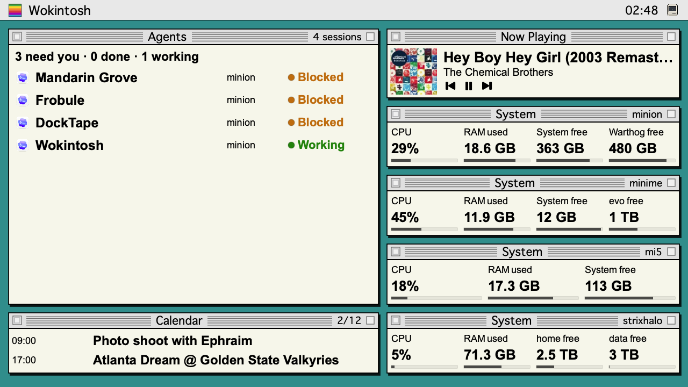

# Wokintosh

A Color Classic-style dashboard for Codex and Claude Code agents, music, calendar, weather and system readings. Designed for and tested on the [Wokyis M5 (10Gbps) retro docking station](https://wokyis.com/products/wokyis-m5-10gbps), with its **5-inch 1280 × 720 display**.

**[Download Wokintosh](https://github.com/anandman/wokintosh/releases/latest)** — Apple silicon, macOS 14 or later. The app and DMG are signed and notarized. The companion agent supports macOS and Linux.

## Getting started

Drag Wokintosh to Applications and open it. **Click the Mac icon at the top right of the dashboard to open Settings**; **Command-comma** works too. Add and arrange widgets in Dashboard, connect Music or Calendar in Connections, and choose your presentation screen in Display.

Widgets can be resized and duplicated independently, with their own content and optional app/link actions. Completed agents stay highlighted Done until reviewed. Optionally choose **Collapse Done after** in an Agent widget’s Content settings to move older notices into **Earlier Done** while keeping them unread. Blocked goals remain visible so unfinished work is not forgotten.

Move your dashboard to another Mac with **Settings → Dashboard → (…) → Export Setup…**, then **Import Setup…** on the other Mac. Import previews machine mappings and creates a backup. **Export Shareable Template…** saves a starting layout with personal machine, location, calendar, and action settings removed.

Wokintosh checks for updates automatically and can download them in the background, installing when you quit. Use **Settings → Updates** or **Check for Updates** in the rainbow menu to install and relaunch sooner. Versions before 1.1 need one final manual installation.

## Remote machines

Wokintosh shows individual Codex and Claude Code sessions across machines over SSH.

1. Make sure your SSH alias or `user@host` already connects from Terminal using keys and trusted host configuration.
2. In **Settings → Machines**, enter the machine name and SSH destination.
3. Choose **Install / Update over SSH**. Wokintosh finds a compatible Python, copies the collector and verifies the connection. Existing hooks and collector state are preserved.

The remote machine needs **Python 3.10 or later**. Versioned installations are detected even when the default `python3` is older. No remote GUI, account, API key or listening server is needed.

Existing sessions are discovered automatically. Optional observer hooks improve permission/input status; they are enabled separately on each machine. See [agent setup and troubleshooting](docs/ADVANCED.md) for hooks, upgrades and blocked-goal integration.

## Remote Now Playing and Calendar

Use another Mac’s Apple Music and selected calendars without connecting those sources on the display Mac.

1. Install Wokintosh 1.3 or later on the source Mac and keep it running; its dashboard can be closed.
2. In that Mac’s **Settings → Connections → Share from this Mac**, enable **Share Now Playing** or **Share selected calendars**. Connect the local source above if needed, and select the calendars to share. Sharing is off by default; Calendar initially shares none.
3. On the display Mac, connect that machine in **Settings → Machines** and choose **Install / Update** to install the 1.3 collector.
4. Select the machine in the Now Playing or Calendar widget’s **Content → Machine** setting.

Remote sources are read-only, carry artwork or upcoming event titles/times over your existing SSH connection, and show stale/offline status. Calendar permissions stay on the source Mac. Notes, attendees, locations and links are not shared. Anyone able to use your SSH account on the source Mac can read its enabled shared sources. Sharing choices stay on that Mac and are excluded from setup exports and templates. Weather uses the location chosen separately for each widget.

## More

[Quick start](QUICKSTART.md) · [Release notes](RELEASE_NOTES.md) · [Contributing](CONTRIBUTING.md)

Original code is [MIT licensed](LICENSE). Third-party names, icons, artwork and services retain their owners’ rights; see [credits](THIRD_PARTY_NOTICES.md). Wokintosh is an independent project.
