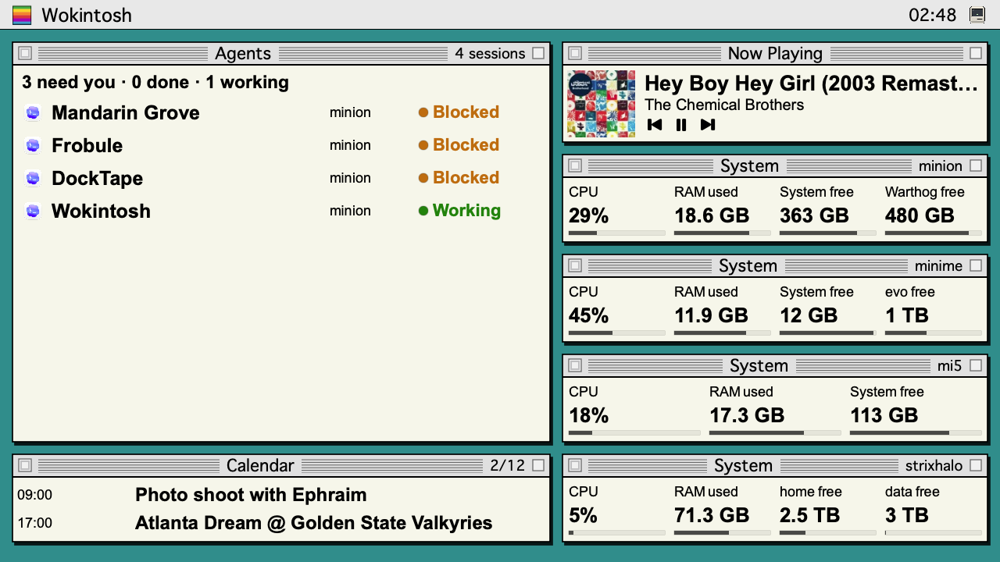

# Wokintosh

Download the signed and notarized macOS app from [GitHub Releases](https://github.com/anandman/wokintosh/releases/latest). Open the DMG and drag Wokintosh to Applications. See [Quick start](QUICKSTART.md) and [release notes](RELEASE_NOTES.md).

A Color Classic-style dashboard for a small Mac display. Arrange independently resizable widgets for individual Codex and Claude Code sessions, Apple Music, system status, clock, weather, and calendar.

Designed for and tested on the [Wokyis M5 (10Gbps) retro docking station](https://wokyis.com/products/wokyis-m5-10gbps), with its **5-inch 1280 × 720 display**.



One custom 1280 × 720 layout: Codex and Claude Code sessions across machines on the left, with attention and unreviewed Done work surfaced first; music and four machines on the right; and the next two calendar events below. Widgets can be duplicated, resized and rearranged independently; each has its own content and click-action settings.

- **Keep track of agents:** Codex and Claude Code sessions from Macs and Linux machines, with attention first and explicit Done/Review and Blocked states.
- **Make a personal dashboard:** music with color artwork and playback controls, filtered calendars, weather, clocks, and CPU, memory and drive readings.
- **Use the space you have:** adaptive compact layouts, optional grid snapping, adjustable text size, and fullscreen presentation.
- **Make it interactive:** open a chosen app or link from each widget, with separate playback and Review controls.

## Releases

**[Wokintosh 1.0.0](https://github.com/anandman/wokintosh/releases/tag/v1.0.0)**

- [Download the signed and notarized macOS app (DMG)](https://github.com/anandman/wokintosh/releases/download/v1.0.0/Wokintosh-1.0.0-macOS-arm64.dmg)
- [Download the macOS / Linux agent collector](https://github.com/anandman/wokintosh/releases/download/v1.0.0/wokintosh-agent-1.0.0.zip)
- [SHA-256 checksums](https://github.com/anandman/wokintosh/releases/download/v1.0.0/Wokintosh-1.0.0-SHA256SUMS.txt)
- [All releases](https://github.com/anandman/wokintosh/releases)

## Install on the display Mac

1. Move **Wokintosh.app** to Applications and open it. Requires an Apple silicon Mac running macOS 14 or later.
2. Press **Command-comma**, or click **Wokintosh** in the dashboard menu bar, to open **Dashboard & Settings**. There is one workspace for adding, configuring, and arranging widgets.
3. The **Dashboard** tab has the widget list, live editing preview, and selected widget’s **Content / Layout / Actions** inspector together. Add from the list’s menu; duplicate/remove from the shared context menu. Move by title bar or resize using the purple corner. Calendar and drive inventories have their own visible native scrollbars.
4. **Snap to grid** and **Align to Grid** are beside the preview. The preview grid, default rectangles, and snapping share the same 16-pixel origin below the dashboard menu bar. Align explicitly adjusts existing custom arrangements. Untouched older default rectangles migrate automatically; custom positions are preserved. The default System rectangle fits CPU, RAM, and two drives at 100% text size.
5. In **Display**, select the dock display and **Present on Display**. Native fullscreen hides the macOS menu bar and Dock; disable **Use native fullscreen** for a borderless window. Changing that option while presenting switches modes immediately, including when a fullscreen transition is already underway. Presentation/display selection are remembered. **Escape** returns to a normal window. Text scale in Display and the calibrated actual-size preview help judge a five-inch panel.

**Display** combines text size, sample data, presentation and actual-size guidance. Turn **Show Dock icon** off to keep Wokintosh out of the Dock; this takes effect immediately and is remembered. The Mac icon at the right of the dashboard menu bar still opens Dashboard & Settings. The six-stripe square at the left opens a menu with Settings and **Quit Wokintosh**, including in fullscreen with the Dock hidden. The menu is part of the dashboard canvas and stays open through refreshes; select an item, click elsewhere on the canvas, or press Escape to close it. Escape closes an open menu before leaving presentation. Command-Q also quits while Wokintosh is active. No macOS menu bar item is added.

Only one Wokintosh copy can start at a time. If an older copy is running, the new copy offers to show it and exits before loading or saving a layout. Quit the running copy, then open the new version. If several older copies are already running, quit the oldest first and your current copy last so the latest dashboard is saved.

Layouts are saved automatically in `~/Library/Application Support/Wokintosh/layout.json`. If a saved file cannot be read, the app shows defaults and preserves the original as a backup before saving changes. Removing a widget does not delete any source data.

**Sample data** is an explicit **Settings → Display** option and is labeled **PREVIEW** on the dashboard. Turn it off to see live sources. It does not represent your actual sessions, calendar, weather, music or machine readings.

## Agent machines: macOS and Linux

The companion collector is a Python 3.10+ command-line program using only the standard library. It does not need a GUI, web server, API key, or an open network port. The dashboard polls remote collectors over your existing SSH connection.

Install the supplied collector on each agent machine:

```sh
mkdir -p "$HOME/.local/bin"
install -m 755 ./wokintosh-agent "$HOME/.local/bin/wokintosh-agent"
"$HOME/.local/bin/wokintosh-agent" snapshot --json
```

In **Settings → Machines**, enter a friendly name, an SSH alias or `user@host`, and the collector path (default `~/.local/bin/wokintosh-agent`). Use **Install / Update over SSH** to check Python, copy the bundled collector with SCP, and verify a snapshot before the connection is saved. An existing collector is backed up during update; hooks and collector state are retained. Use **Connect Existing Collector** when it is already installed. A local collector-file export remains an advanced option. Saved machines share the settings page’s normal scrolling, so all machines and their Update/Remove controls remain reachable. SSH keys and host trust must already work from Terminal; setup uses batch mode and will show an error rather than ask for a password or trust an unfamiliar server automatically. Local collection also needs Python 3.10+; the app checks the actual version and detects versioned Python, Homebrew and standard installation paths.

Remote installation checks the interpreter’s actual version in the noninteractive SSH environment. A compatible `python3` keeps priority; otherwise it searches versioned executables such as `python3.12` in SSH’s PATH, standard installation directories, Homebrew version-specific prefixes and Python.org frameworks. The installed collector is pinned to the selected absolute interpreter path, so later polling does not depend on `python3` pointing to that version. Wokintosh does not change your PATH or Python symlinks. For a manual copy with an older default Python, invoke the script explicitly with your newer interpreter until you use Install / Update over SSH.

In the Dashboard inspector, each row is a distinct session/task, including multiple sessions of the same harness on one machine. The widget can filter by machine and harness and optionally include reviewed/recent inactive sessions and helper agents. Sessions needing attention come first; completed work stays highlighted **Done** until you mark it reviewed using its **Review** button, or the widget header’s check control to mark all Done as reviewed. These controls are available on the dashboard itself. Done notices survive restarting Wokintosh; new activity supersedes the previous completion. First connection establishes a baseline and does not import old completed history. New completions after that baseline are shown, including work finishing while Wokintosh is closed. Already-unreviewed notices from an earlier version remain until reviewed. Helper agents, including internal review assistants, are hidden by default and labeled Helper when included. At sufficient width, compact rows show the provider icon, roughly the first 20 characters of the session name, machine and status on one line. Full titles and metadata remain in help/accessibility; the check beside Done marks that session reviewed. Narrow widgets and larger text reflow to two lines with fewer rows. Overflow is always visible. Unknown or disconnected state is shown explicitly; bars are used only for measured system readings.

### Blocked goals

**Blocked** is an unfinished-goal state, separate from a completed turn. It stays visible beyond recent transcript history, across restarts, and while a previously connected machine is offline. Real permission/input requests take priority. The row stays compact; details are available in help/settings.

Right-click a session to **Mark Blocked**; **Clear Manual Blocked** removes only that local dashboard annotation. Agents on either Mac or Linux can publish the same durable signal for Codex or Claude Code:

```sh
wokintosh-agent goal-status --provider codex --session-id <session-id> --status blocked --title "Release testing" --project sample-project
```

Use `--provider claude` for Claude Code. Publish `--status active` or `--status complete` when the goal is unblocked. Recognized successful direct Codex goal-tool output can supply this automatically when exposed by the client. Existing historical goals and clients without structured goal output need explicit registration or manual marking; Wokintosh does not guess from final-response wording. Claude idle reminders do not count as blocked or as requests for input.

### Precise attention signals

Read-only transcript discovery works without changing agent settings. For reliable permission/input lifecycle signals, enable the optional observational hooks. The Mac app offers explicit buttons for its local harnesses; on a remote machine run:

```sh
~/.local/bin/wokintosh-agent install-hooks --provider codex
~/.local/bin/wokintosh-agent install-hooks --provider claude
```

**Enable / Update Hooks** in Settings → Machines installs or refreshes clearly named Wokintosh observers. Both providers receive event-specific Wokintosh status messages, such as Working, Needs permission, and Done; commands identify Wokintosh explicitly. Existing settings are preserved and backed up. Hooks return neutral JSON and never approve, deny, block, or continue agent work. For Codex, review and trust new or changed observers in `/hooks` before they can run. Restart the client and resume existing conversations after installation to ensure observers load; no new conversation is required. Existing sessions are discovered without restarting, but earlier hook events are not replayed. See [Codex hook trust](https://learn.chatgpt.com/docs/hooks). Codex uses an existing inline `~/.codex/config.toml` hook configuration when present, otherwise `~/.codex/hooks.json`; Claude Code uses `~/.claude/settings.json`. The installer migrates its own marked JSON handlers into an existing TOML hook source. Unrelated hooks and metadata are preserved. If unrelated JSON content remains, the installer reports which handler groups/metadata remain. To consolidate them explicitly into the existing supported TOML configuration, run:

```sh
~/.local/bin/wokintosh-agent install-hooks --provider codex --consolidate-sources
```

Consolidation validates the migration first and backs up the original files. Unrelated observers, matchers and settings are preserved. Unsupported or ambiguous data is refused before settings are changed. Existing Wokintosh hooks from earlier script versions are updated without adding duplicate observers; collector state is retained. Lifecycle events remain separate entries for Codex trust review. The collector stores bounded summaries in the platform's Wokintosh state directory, not full transcripts. Provider formats can change; unfamiliar or stale lifecycle state remains unknown rather than inventing progress.

The initial collector bounds discovery to recent files and caches unchanged parses. It is intended for an ambient view of active work, not a complete searchable transcript archive.

## Widget click actions

Select a widget in **Settings → Dashboard → Actions**. Each widget independently supports **Do nothing** (the default), **Open app**, or **Open link**. Choose App uses the native application picker and saves the app’s identity; choosing an app does not launch it. Links may be web URLs or links handled by an installed app. Use **Test Action** to try the configured target. Changes save automatically and are copied when duplicating a widget.

For example, select CARROT Weather for Weather, Fantastical for Calendar, Activity Monitor for System, Music for Now Playing, or Clock for Clock. Installed suggestions are offered where available. Applications always open on the display Mac; Activity Monitor shows that Mac’s processes even if the System widget displays a remote machine.

Agents also supports **Open harness app**: clicking a session’s name or identity opens the chosen Codex or Claude app on this Mac. The two app choices are configurable. This opens the application; it does not navigate to an exact session or resume a remote CLI. Opening a Done session never marks it reviewed. Use its separate Review control for that.

Music artwork and track details open the configured target; playback controls still perform only their media action. Weather and Calendar source/configuration controls remain separate. App/link actions do not run from widget clicks in the layout editor or sample-data mode; the inspector’s explicit Test Action button can still be used. Existing editor controls, including widget removal, playback and Review, keep their functions. A launch failure displays an action error, with no permanent status footer.

## Personal widgets

- **Apple Music:** in **Settings → Connections**, click **Connect Apple Music** while Music is running and grant macOS automation access. Wokintosh reads the actual track and color artwork. Polling does not launch Music. Playback buttons control Music only when clicked. Compact wide widgets place previous/play-pause/next below the title and artist, preserving the full metadata width and the artist’s 20-point base size. Shorter tiles use inline controls when they fit; narrower tiles add controls when height allows. Larger widgets retain progress and duration. Connected access is shown separately from playback. A closed Music app has unverified access rather than a false denial; disabling reads clears the displayed track. Artwork failures are explained in the Music connection/widget settings without interrupting playback; tracks without a library ID use a guarded current-track fallback. When Music does not expose a cover, **Look up missing artwork in Apple’s catalog** (enabled by default) sends the current title, artist and album to Apple’s catalog. It accepts only a matching title, artist, album and duration; it preserves mix/version names and refuses conflicting covers. Turn this off in Connections to cancel pending lookup and use only artwork exposed locally by Music. Catalog availability differs by region/release, so an exact cover cannot be guaranteed for every track.
- **Calendar:** in **Settings → Connections**, click **Connect Calendar** and grant EventKit access. Upcoming events are read locally. In **Settings → Dashboard → Content**, choose individual calendars (with account/source labels), include or exclude all-day events, and select **Only next event**. For a personal + work timed-event view, select those two calendars and turn all-day events off. Filtering happens before the event limit. With **Only next event** off, widgets show as many readable agenda rows as fit; a 688 × 112 widget fits two events at 100% text size. The title bar reports visible/total events, such as **2/4**. Narrower agenda rows stack the date above the title. With only one event or less room, the widget shows one detailed event with a full-width title, wrapping when height permits. Full event details remain available in help. Generic same-time mirrors such as “Blocked Time” yield to a selected event with a real title; standalone blocks remain. Add title phrases (one per line, case insensitive) to hide other unwanted events for that widget. Permission is never requested just by launching Wokintosh.
- **Weather:** select the Weather widget in **Settings → Dashboard → Content** to search for an explicit city and choose Celsius or Fahrenheit. Each Weather widget has its own location and units. Existing widgets retain the previous shared choice on upgrade; new widgets start unconfigured. No device location is inferred. Weather is provided by [Open-Meteo](https://open-meteo.com/); place search uses [GeoNames](https://www.geonames.org/). See [Open-Meteo terms and attribution](https://open-meteo.com/en/terms). The widget’s Configure button opens its own Content settings. Cached weather is marked offline when refresh fails.
- **System:** select this Mac or a connected agent machine. Choose CPU, memory and individual mounted drives in **Settings → Dashboard → Content**. Multiple drives can be shown together. At 100% text size, a compact 544 × 112 widget shows four readings in one row with larger values and quiet usage gauges. RAM is labeled used; drive values are labeled free; the gauges show used capacity. Narrower widgets or wider values reflow into a 2×2 arrangement when that fits, including four readings at 480 × 112. Compact values use less decimal precision; help/accessibility retains the fuller reading. Larger text or additional readings show an explicit overflow count; enlarge the widget to reveal them. CPU, memory and storage are measured by the collector. Update remote collectors for drive inventory; older collectors still supply their original disk reading. Drive selections identify mount points; a missing selected mount shows unavailable data. Usage gauges stay visible in compact layouts; unavailable readings show a dash. CPU uses host counter deltas, with the first sample unavailable until a second poll supplies an interval.
- **Clock:** follows the Mac's locale and time settings. A menu-bar clock remains visible independently of the optional clock widget.

Release builds are Developer ID signed and notarized for direct distribution. No account or telemetry service is included. Physical legibility should be checked on the actual Wokyis panel at your usual viewing distance; its native resolution is 1280×720.

## Build and distribution

Build with `script/build_and_run.sh --build-only` or create an ad hoc development ZIP with `script/package.sh`. Build products and staging stay under `/private/tmp`, outside the source folder. Run `swift test --scratch-path /private/tmp/wokintosh-build` and `python3 -m unittest discover -s collector/tests`.

For a distributable release, set `WOKINTOSH_SIGNING_IDENTITY` to a Developer ID Application certificate fingerprint and `WOKINTOSH_NOTARY_PROFILE` to a saved notarytool keychain profile, then run `script/release.sh`. This signs with hardened runtime and the Music automation/Calendar entitlements, notarizes and staples the app, creates and notarizes a DMG, and writes a collector archive and SHA-256 checksums to `dist/`. It does not publish a GitHub release or modify an installed app.

## Contributing and license

Contributions are welcome. See [CONTRIBUTING.md](CONTRIBUTING.md) for setup, tests and pull request guidance. Wokintosh’s original code is available under the [MIT license](LICENSE). Third-party names, icons, fonts, music artwork and services retain their owners’ rights; see [credits](THIRD_PARTY_NOTICES.md).
