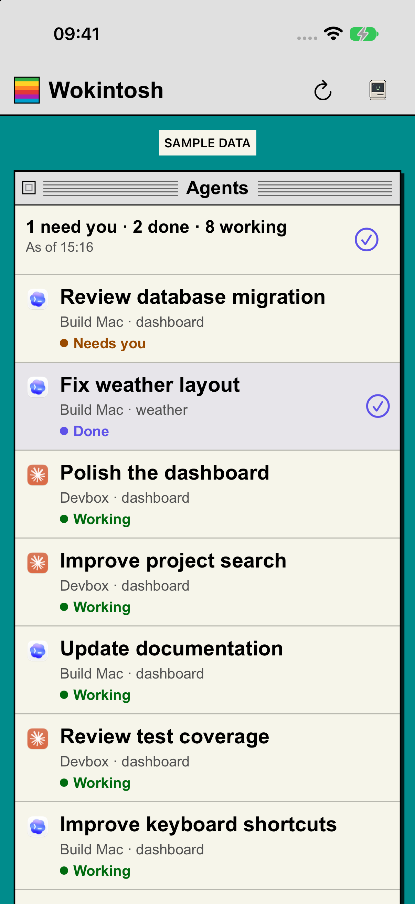
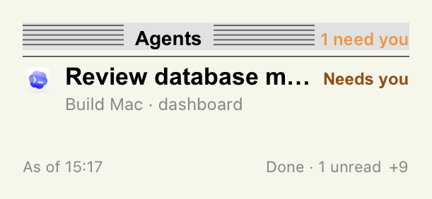
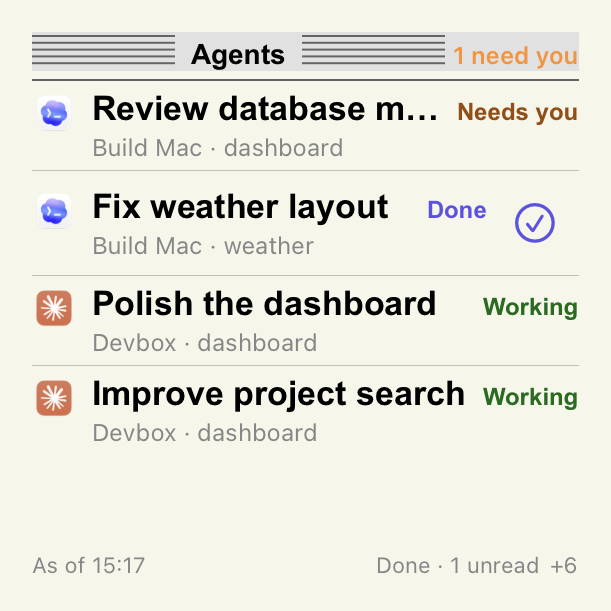
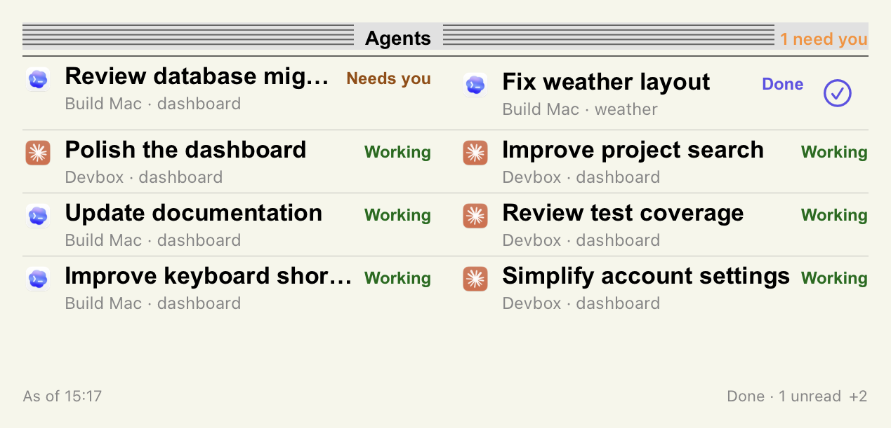
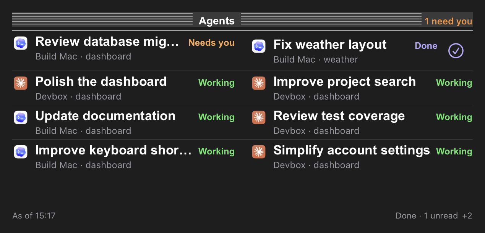
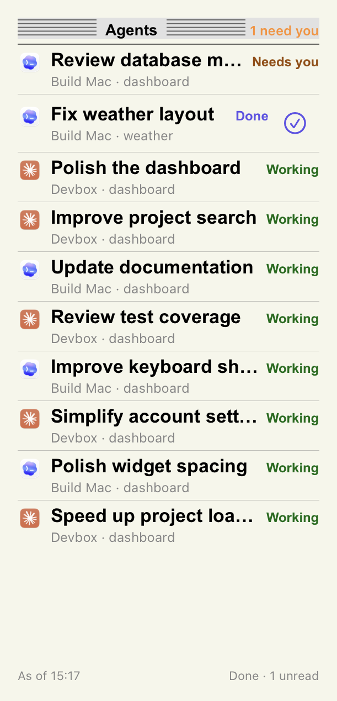

# Wokintosh on your iPhone or iPad

The companion is built from source and installed directly on iPhone or iPad (iOS/iPadOS 17+), with medium and large Home Screen Agent widgets and a full-width extra-large option on iPad. The app and extension share the portable WokintoshCore models; remote collectors keep using SSH.

The iPad app supports portrait and landscape. All widget sizes use the same pairing and session links. Extra-large uses two columns and shows up to ten sessions. On iOS/iPadOS 27+, the app also supports Apple's tall extra-large portrait family where the system offers it; Apple documents that family for Today View on iPad. WidgetKit does not offer an arbitrary full-width, double-height Home Screen size.

## Build and install

There is no prebuilt iOS download or TestFlight distribution yet. Build with your own Apple Account in **Xcode 27 or later** on a compatible Mac; the app runs on **iOS/iPadOS 17 or later**. The newer tall widget family is guarded for iOS/iPadOS 27+. The publishing Mac needs Wokintosh 2.0 or later, available as a signed Mac download or a source build.

1. Clone the repository and create your private signing configuration:

   ```sh
   git clone https://github.com/anandman/wokintosh.git
   cd wokintosh
   cp iOS/Config/Signing.local.xcconfig.example iOS/Config/Signing.local.xcconfig
   open iOS/WokintoshPhone.xcodeproj
   ```

2. Sign in under **Xcode → Settings → Apple Accounts**, then edit `iOS/Config/Signing.local.xcconfig` with your team and identifiers. For example, replace all three example values:

   ```xcconfig
   DEVELOPMENT_TEAM = YOUR_TEAM_ID
   WOKINTOSH_PHONE_BUNDLE_ID = com.example.yourhandle.wokintosh
   WOKINTOSH_PHONE_APP_GROUP_ID = group.com.example.yourhandle.wokintosh.shared
   ```

   Use a unique reverse-domain bundle ID and an App Group owned by your team. The widget ID is derived automatically by appending `.agents`; both targets use the same team, App Group and shared Keychain group. The local file is ignored by Git. Do not commit provisioning profiles, certificates or signing credentials. Changing these identifiers later creates a separate app/storage identity and requires pairing again.

3. Select **WokintoshPhone** and check **Signing & Capabilities** for both **WokintoshPhone** and **WokintoshAgentWidget**. Keep automatic signing enabled. Resolve any provisioning prompts for **App Groups** and **Keychain Sharing** using your account. A Mac Developer ID certificate cannot sign an iPhone build; Xcode may create an Apple Development certificate and device profiles.
4. Connect your iPhone or iPad to the Mac by USB, unlock it and trust the Mac if prompted. Enable **Settings → Privacy & Security → Developer Mode** on the device if requested, including its restart/confirmation. Select that device as Xcode's run destination and choose **Product → Run**. After initial pairing, Xcode can offer wireless development on a reachable local network; Tailscale alone is not a substitute for Xcode's device pairing.
5. Install Wokintosh 2.0 or later on the publishing Mac from the [Mac download](https://github.com/anandman/wokintosh/releases/latest). To build it yourself from the same checkout:

   ```sh
   script/build_and_run.sh --build-only
   ```

   Quit any older Wokintosh app, then open the staged `Wokintosh.app` path printed by the helper. Development builds do not enable automatic release updates. Continue with pairing below.

Apple documents [account options and Personal Team limits](https://developer.apple.com/help/account/basics/about-your-developer-account) and [supported iOS capabilities](https://developer.apple.com/help/account/reference/supported-capabilities-ios/). A free Personal Team has limited apps/devices and **seven-day provisioning**, so development installs need rebuilding/reinstalling after expiry. Distribution through TestFlight requires Apple Developer Program membership. This project does not currently provide a TestFlight workflow for either platform.

The checked-in Xcode project is ready to open; XcodeGen is unnecessary for normal builds. If you change targets or capabilities, edit `iOS/project.yml` and regenerate with XcodeGen 2.46 or later:

```sh
cd iOS
xcodegen generate
```

Once Xcode signing/device setup is ready, the command-line helper is another installation option, run from the repository root:

```sh
script/install_iphone.sh --device YOUR_DEVICE_UDID
```

Find the device identifier in **Xcode → Window → Devices and Simulators**. The helper builds outside the checkout in a separate folder for each device, verifies the signed app, embedded widget and their matching App Group/Keychain capabilities, and installs to the explicitly chosen device. Separate folders keep iPhone and iPad asset thinning from invalidating each other's signed resources. `--build-only` prepares a signed build without installing; `--dry-run` prints the operations. `--team YOUR_TEAM_ID` overrides the local team for that invocation. The helper does not request passwords or revoke certificates.

For Simulator builds, choose an iPhone/iPad simulator in Xcode. No device provisioning is needed. The Debug launch argument `--sample-data` shows fictional sessions without pairing or connecting to a Mac; these are also the source of the documentation previews.

## Connect the display Mac

1. Use Wokintosh 2.0 or later on the Mac. Open **Settings → iPhone & iPad** and enable publishing.
2. Select the Agent widgets to publish. Their machine/provider/helper/finished/Done-collapse choices stay on the Mac and also control your device’s contents.
3. Follow the private Tailscale setup shown there. The dedicated route is:

   ```sh
   tailscale serve --bg --https=9443 --set-path=/wokintosh http://127.0.0.1:8787
   ```

   This uses Tailscale Serve, not Funnel, and preserves other ports/routes. If Tailscale requests HTTPS consent, finish it through its own setup page. Keep access limited to your intended tailnet devices/users. Do not replace another existing service on port 9443.
4. Paste the HTTPS `.ts.net` address shown by Tailscale into Wokintosh and save it. Wokintosh fills the dedicated port/path.
5. Show the private pairing code. In the companion app choose **Scan pairing code**. The code grants viewing access to selected widgets and, when **Allow Agent controls** is enabled on the Mac, review/manual Blocked controls. Keep it private.
6. Add the **Agents** widget using the steps below.

The display Mac and Wokintosh must remain running. The dashboard window can be closed. If macOS pauses the app during memory pressure, resume it before refreshing the companion. A paused or sleeping publisher cannot answer requests. Your iPhone or iPad needs its Tailscale connection. There is no public relay, iCloud sync, remote command endpoint, or keep-awake change.

## Add the Home Screen widget

1. Open Wokintosh on your paired iPad and tap **Refresh** so its saved list includes the latest collector links.
2. Long-press an empty part of the Home Screen, then choose **Edit → Add Widget**.
3. Search for **Wokintosh**, choose **Agents**, and swipe to the **extra-large** size for a full-width, two-column list on iPad. Medium and large remain available. Tap **Add Widget**, then **Done**.
4. Long-press the new widget and choose **Edit Widget**. Set **Published widget** to your Mac's **Agents** widget (or the name you gave it).
5. Tap a session row to open its official app directly. Details appear only if the link is missing or cannot be opened.

These Home Screen controls follow [Apple's iPad widget instructions](https://support.apple.com/en-ie/guide/ipad/ipadb0de8630/27/ipados/27). For the tall option on iPadOS 27+, swipe right to Today View and use its widget gallery. See Apple's [extra-large](https://developer.apple.com/documentation/widgetkit/widgetfamily/systemextralarge) and [extra-large portrait](https://developer.apple.com/documentation/widgetkit/widgetfamily/systemextralargeportrait) families for platform availability. Compact sizes and larger text may show fewer rows with an overflow count. USB is unnecessary after installation. Keep Tailscale connected and Wokintosh running on the publishing Mac. Refresh timing remains controlled by iPadOS; the widget's **As of** time shows the age of its source data.

## Review and status controls

On your publishing Mac, enable **Settings → iPhone & iPad → Allow Agent controls**. It is off by default. While enabled, anyone with the current pairing key can use these controls for selected published Agent widgets. Existing pairings keep working; the setting and key stay out of setup exports/templates.

The app follows the desktop interactions:

- Tap a session to open its official app immediately.
- Tap its purple Done checkmark to mark that completion reviewed. New work can produce a new Done notice normally.
- Tap the header checkmark to review the shown Done notices, including represented Earlier Done. Open **Earlier Done** to review those individually or as a group.
- Long-press a row for **Mark Blocked** or **Clear Manual Blocked**. A provider-reported blocked goal is cleared in its own app.
- Tap the Mac icon for **Settings**, including connection, published widget selection, pairing and unpairing.

Reviewing clears the unread notice; a Mac widget configured to include inactive sessions can still show the session. Commands change Wokintosh bookkeeping on the publishing Mac. They do not send prompts, approve actions, stop agents, or alter provider goals.

Widgets use the same provider artwork and a compact striped header, with colors that follow light/dark appearance. Their purple Done checkmark reviews that notice directly. Tap the widget background/header to open its Agent list, then long-press a row for status controls. iOS reserves the widget's long-press menu for its own options. Separate action targets and larger text can reduce visible row counts; overflow remains accurate.

Changes are saved on the publishing Mac and appear on other devices when they refresh. Widget background timing remains controlled by iOS. An old action cannot acknowledge newer work or clear a newer manual annotation. Bulk review covers only the exact notices represented in the received feed, including under the shared byte limit. If the Mac is unreachable, the action is not queued; refresh and retry after reconnecting. A stale action reports that the session changed. If a response is lost, the change may already have been saved on your Mac; the app explains that uncertainty. Automatic widget refreshes keep the warning visible. After inspecting the current state, tap Refresh or pull to refresh in the app to acknowledge it. Nothing is reported as confirmed until the Mac has saved it.

Some historical temporary-looking sessions only have hook events, without saved thread/helper metadata. Wokintosh cannot safely classify every such session as disposable; use Review Done to clear these notices. Untitled sessions or missing links alone are not reasons to hide work.

## Session links and freshness

Update the collector on each source machine to supply session links. Codex uses its normal thread UUID. Claude needs a Remote Control bridge ID from `CLAUDE_CODE_BRIDGE_SESSION_ID` in observational hook invocations (Claude Code v2.1.199+). Enable/update the observer through the existing Machines setup and review/trust it normally. Wokintosh does not enable Remote Control automatically. After connecting Remote Control, the next hook event can establish the association; a missing bridge ID stays unavailable. PID metadata is not used as a fallback.

On the initial user's iPhone, both Claude forms opened an exact existing session. The preferred target is `claude://code/{bridge-id}`, with `https://claude.ai/code/{bridge-id}` as backup. `codex://threads/{thread-id}` also opened a different existing session with the unchanged UUID; this mobile route remains an undocumented compatibility contract. The explicitly labeled backup **Open ChatGPT (new chat)** uses `https://chatgpt.com/app`; it opens ChatGPT but does not select a Codex view or session. A failed exact-session link never opens that backup automatically. Do not substitute `/c/{thread-id}`.

Rows route through the Wokintosh app into the official app without an intermediate details sheet. If the link is missing or the OS rejects it, details show the title, machine, project and state, with an explicit backup button when available. The OS accepting a link does not prove the official app resolved the right host/chat.

Widgets request updates about every 15 minutes; iOS controls the schedule and can wait longer. **As of** is based on source observation, not a new HTTP response around old data. Snapshots become stale after 30 minutes and disconnected sources show Offline immediately, including an empty list. Mixed-source widgets also mark affected rows Offline or Stale. Compact widget sizes and larger text use fewer rows with accurate overflow counts; the layout keeps the source time visible. Opening a session never reviews Done. Explicit review/manual Blocked controls require the Mac’s separate permission; companion views never send prompts, approve actions, or control the source session.

Publishing consent/credentials stay out of setup exports and templates. Imported/replaced widgets require publication selection again. Stopping publishing prevents new access; a paired device can retain its last snapshot until it refreshes. Change the access key to require pairing again, or **Unpair** in the companion app to clear its credential and saved data.

## Preview gallery

These images render the current app and widget views with fictional sessions, machines and projects. Widget padding and available space vary by device and text size.

<p></p>

| Medium widget | Large widget |
| --- | --- |
|  |  |

Full-width iPad widget:



Dark appearance follows the system:



Tall family, where offered by iOS/iPadOS 27+:



## Antigravity and OpenCode in 2.1

Antigravity App/CLI and OpenCode App/CLI are **Untested integrations**. The app and widgets show their official logos, Untested labels and the same Wokintosh review controls. Antigravity IDE is excluded. No live-provider end-to-end test has been performed.

A missing mobile link opens session details with setup guidance. Configure a verified per-session HTTPS navigation link on the source machine using the [provider guide](PROVIDERS.md). Antigravity needs its Remote Control instance and conversation link; a conversation ID alone is insufficient. OpenCode needs an authenticated web interface reachable from the device. Wokintosh does not start or publish either service automatically.
